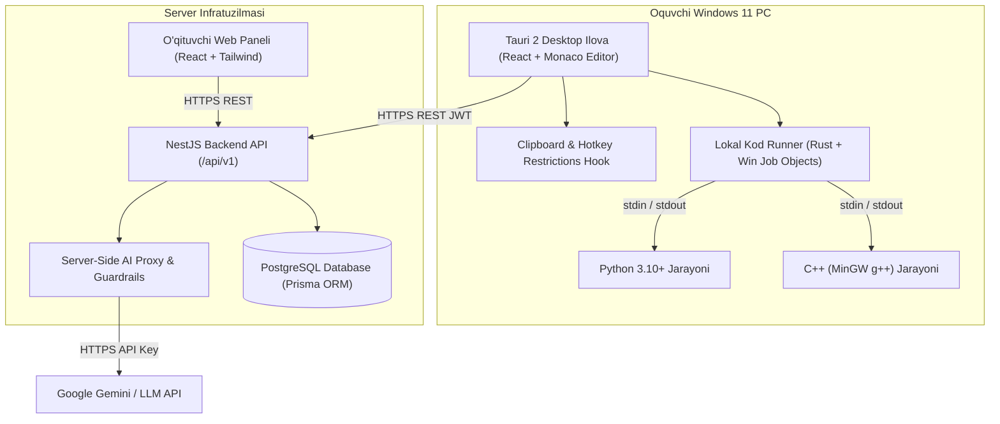

# CodePractice Arxitekturasi

CodePractice — o‘quvchilar uchun Windows 11 desktop ilovasi va o‘qituvchilar uchun web-paneldan iborat majburiy qo‘shimcha dasturlash mashqlari tizimi.

## 1. Muhim Arxitektura Qoidalari

1. **Ma’lumotlar bazasiga to‘g‘ridan-to‘g‘ri ulanish yo‘q**: Desktop ilova hech qachon to‘g‘ridan-to‘g‘ri PostgreSQL bazasiga ulanmaydi. Barcha amallar NestJS REST API orqali autentifikatsiya qilinadi.
2. **Kodni lokal bajarish (Local Runner)**: O‘quvchi yozgan Python va C++ kodlari serverga yuklanmaydi, o‘quvchining o‘z Windows 11 kompyuterida alohida izolyatsiyalangan vaqtinchalik muhitda bajariladi. Bu serverga bo‘lgan hisoblash yuklamasini kamaytiradi va bir vaqtning o‘zida yuzlab o‘quvchilarning mustaqil ishlashini ta’minlaydi.
3. **Yashirin testlar himoyasi**: O‘qituvchi kiritgan yashirin testlarning input va kutilgan javoblari klientga to‘liq oshkor etilmaydi.
4. **Maxfiylik va API kalitlari**: LLM (AI) kalitlari, JWT sirlari va ma’lumotlar bazasi parollari faqat backend serverda saqlanadi. Klient ilovalarga hech qachon tarqatilmaydi.

## 2. Xavfsizlik va Cheklovlar Modeli

- **Clipboard nazorati**: Desktop ilova doirasida `Ctrl+C`, `Ctrl+X`, `Ctrl+V`, `Drag-and-Drop` hamda o‘ng tugma kontekst menyusi bloklanadi.
- **Job Objects cheklovlari**: Kod bajarilishida `JOB_OBJECT_LIMIT_PROCESS_MEMORY`, vaqt chegarasi (timeout) va jarayonlar daraxtini majburiy to‘xtatish qo‘llaniladi.
- **AI yechim cheklovi (Guardrails)**: Serverda AI javoblari tekshirilib, to‘liq tayyor kod bloklarini berish cheklanadi.
